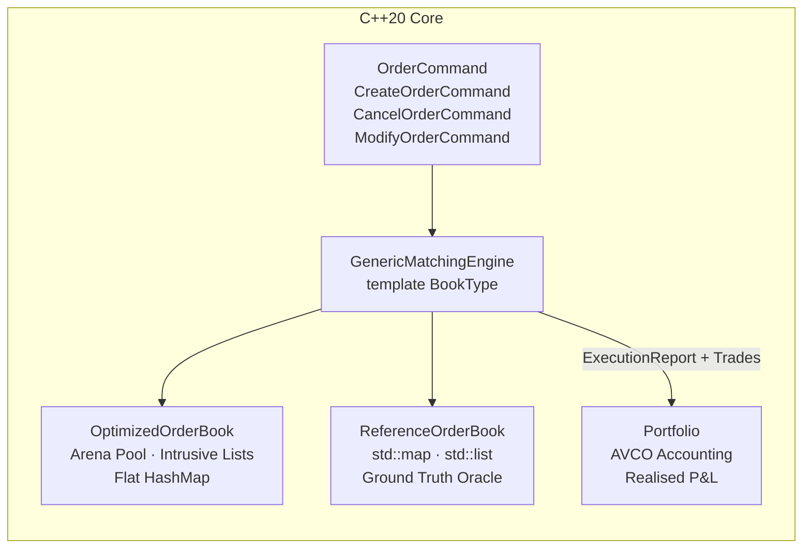
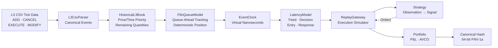
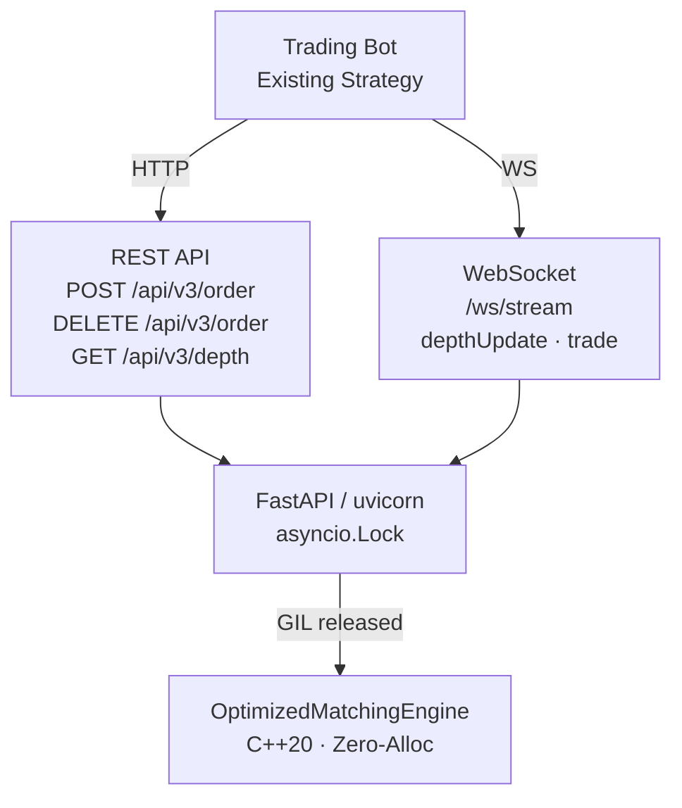

# QuantEngine

<div align="center">

[](https://en.cppreference.com/w/cpp/20)
[](https://cmake.org/)
[](https://www.gnu.org/licenses/agpl-3.0)
[](https://github.com/shubham-dataeng/QuantEngine/actions/workflows/ci.yml)
[](https://github.com/shubham-dataeng/QuantEngine/actions/workflows/build-wheels.yml)
[](#)
[](https://pypi.org/project/quantengine/)

**A production-grade, deterministic C++20 Limit Order Book matching engine with a Binance-compatible REST + WebSocket exchange API.**

[Getting Started](#getting-started) · [Architecture](#architecture) · [Exchange API](#exchange-api-server) · [L3 Historical Replay](#l3-historical-replay) · [Benchmarks](#benchmarks) · [Commercial License](#commercial-licensing)

</div>

---

## Why Determinism Matters

Most backtesting frameworks treat order execution as a black box. They assume fills happen at the quoted price, ignore queue position, and cannot reproduce a historical book state bit-for-bit.

QuantEngine takes a different approach:

- **Zero-allocation hot path.** The `OptimizedOrderBook` uses a 65,536-slot arena (`OrderPool`) with 32-bit intrusive doubly-linked lists and a flat hash map for price levels. The matching loop does not touch the heap.
- **Canonical binary state hash.** After every event, a 64-bit FNV-1a hash over the serialised book state produces a single integer. Two engines that process the same command log **must** produce the same hash — this is enforced by a cross-engine invariant test on every CI push.
- **L3 event-time replay.** The historical replay subsystem reconstructs the full exchange book from raw L3 tick data (ADD / CANCEL / EXECUTE / MODIFY), tracks FIFO queue position for each resting order, and simulates virtual latency for your strategy's observation, decision, and submission paths.
- **Full exchange API.** The `server.py` FastAPI layer wraps the C++ engine in a Binance-compatible REST + WebSocket server. Point your existing trading bot at `localhost:8080` and it will not know the difference.

---

## Architecture

### Core Matching Engine



### L3 Historical Replay Pipeline



### Exchange API Layer



---

## Getting Started

### Prerequisites

| Tool | Minimum version |
|------|----------------|
| GCC or Clang | 13+ (C++20 required) |
| CMake | 3.28+ |
| Ninja | 1.11+ |
| Python | 3.9+ |

```bash
# Ubuntu 24.04
sudo apt-get install build-essential cmake ninja-build python3-dev python3-pip

# macOS (Homebrew)
brew install cmake ninja
```

### Clone and Build (C++)

```bash
git clone --recurse-submodules https://github.com/shubham-dataeng/QuantEngine.git
cd QuantEngine

# Release build (maximum optimisation)
cmake --preset dev-release
cmake --build build/release -j$(nproc)

# Sanitizer build (AddressSanitizer + UndefinedBehaviourSanitizer)
cmake --preset dev-sanitizer
cmake --build build/dev-sanitizer -j$(nproc)
```

### Run C++ Tests

```bash
# All 248 tests (release)
./build/release/tests/quantengine_tests

# With sanitizers
./build/dev-sanitizer/tests/quantengine_tests
```

Expected output:
```
[==========] 248 tests from 18 test suites ran.
[  PASSED  ] 248 tests.
```

### Install Python Bindings

```bash
pip install .                      # core bindings only
pip install ".[server]"            # + FastAPI exchange server
pip install ".[all]"               # + tests + replay
```

### Quick Python Example

```python
import quantengine as qe

engine = qe.OptimizedMatchingEngine()

# Place resting bid
r = engine.submit_order(1, qe.Side.Buy, 50_000_00, 10)   # price in ticks
print(r.status)   # OrderStatus.Resting

# Aggressive sell crosses the book
r = engine.submit_order(2, qe.Side.Sell, 49_999_00, 5)
print(r.status)          # OrderStatus.Filled
print(len(r.trades))     # 1

# Deterministic canonical hash
print(f"0x{engine.canonical_hash():016x}")
```

---

## Exchange API Server

The `server.py` module boots a **Binance-compatible mock exchange** powered by the C++ engine. Point any standard trading bot at it with zero code changes.

### Start the Server

```bash
python server.py --host 0.0.0.0 --port 8080 --tick-size 0.01
```

Or with Docker:
```bash
docker compose up --build
```

### REST Endpoints

| Method | Path | Description |
|--------|------|-------------|
| GET | `/api/v3/ping` | Connectivity check |
| GET | `/api/v3/time` | Server time (Unix ms) |
| GET | `/api/v3/exchangeInfo` | Symbol and filter metadata |
| GET | `/api/v3/depth?symbol=BTCUSDT&limit=20` | L2 order book snapshot |
| GET | `/api/v3/trades?symbol=BTCUSDT` | Recent trade history |
| GET | `/api/v3/ticker/bookTicker?symbol=BTCUSDT` | Best bid/ask |
| POST | `/api/v3/order` | Place new limit order |
| DELETE | `/api/v3/order?orderId=…` | Cancel a resting order |
| GET | `/api/v3/order?orderId=…` | Query order status |
| GET | `/api/v3/openOrders?symbol=BTCUSDT` | List all resting orders |
| GET | `/qe/audit` | C++ invariant audit + canonical hash |
| POST | `/qe/reset` | Reset engine to empty state |

### Example: Place and Cancel an Order

```bash
# Place a bid
curl -X POST http://localhost:8080/api/v3/order \
  -H "Content-Type: application/json" \
  -d '{
    "symbol": "BTCUSDT",
    "side": "BUY",
    "type": "LIMIT",
    "timeInForce": "GTC",
    "quantity": "5",
    "price": "50000.00",
    "newClientOrderId": "my_bot_order_1"
  }'
```

Response (Binance schema):
```json
{
  "symbol": "BTCUSDT",
  "orderId": 1,
  "clientOrderId": "my_bot_order_1",
  "transactTime": 1727890123456,
  "price": "50000.00",
  "origQty": "5",
  "executedQty": "0",
  "status": "NEW",
  "timeInForce": "GTC",
  "type": "LIMIT",
  "side": "BUY",
  "fills": []
}
```

```bash
# Cancel it
curl -X DELETE "http://localhost:8080/api/v3/order?symbol=BTCUSDT&orderId=1"
```

### WebSocket Stream

```bash
# Subscribe to real-time depth updates and trade stream
wscat -c ws://localhost:8080/ws/stream
```

On connection you receive an immediate book snapshot, then live `depthUpdate` and `trade` events after every order mutation — matching the [Binance diff-depth stream](https://developers.binance.com/docs/binance-spot-api-docs/web-socket-streams) format.

---

## L3 Historical Replay

### CLI Tool

```bash
./build/release/quantengine_cli replay-l3 \
    --input tests/fixtures/l3_sample.csv \
    --tick-size 0.01
```

Sample output:
```
╔══════════════════════════════════════════════════════════════════╗
║          QuantEngine L3 Historical Replay — Results              ║
╠══════════════════════════════════════════════════════════════════╣
║  Events processed   │ 1,000,000                                  ║
║  Simulated fills    │ 5,432                                       ║
║  Queue stats        │ ahead_min=0  ahead_max=12480  avg=3201      ║
║  Virtual latency    │ feed=1µs  decision=5µs  entry=2µs          ║
║  Realised P&L       │ +$1,240.55                                  ║
║  Canonical hash     │ 0x3f9a4b2c1d8e7f60                          ║
╚══════════════════════════════════════════════════════════════════╝
```

### Python Replay Utility

```bash
python historical_replay.py \
    --input data/BTCUSDT_L3.csv \
    --output replay_result.json \
    --tick-size 0.01 \
    --snapshot-interval 50000 \
    --symbol BTCUSDT
```

Output JSON contains throughput metrics, periodic depth snapshots, the canonical hash, and invariant verification.

### L3 CSV Format

```csv
timestamp_ns,event_type,order_id,side,price,quantity
1700000000000000000,ADD,1001,B,50000.00,10
1700000000001000000,ADD,1002,S,50100.00,5
1700000000002000000,EXECUTE,1001,,50000.00,10
1700000000003000000,CANCEL,1002,,,
```

| Field | Values | Notes |
|-------|--------|-------|
| `timestamp_ns` | int64 | Exchange nanosecond timestamp |
| `event_type` | `ADD` `CANCEL` `EXECUTE` `MODIFY` | |
| `order_id` | int64 | Unique per resting order |
| `side` | `B` `S` | Ignored for CANCEL/EXECUTE |
| `price` | decimal | Ignored for CANCEL/EXECUTE |
| `quantity` | int | Remaining quantity at this event |

---

## Benchmarks

All benchmarks run on: **AMD Ryzen 7 7840HS, GCC 13.3.0, `-O3 -march=native`**, Release build, isolated core.

### Matching Engine

| Scenario | Throughput | Mean Latency | p99 Latency |
|----------|-----------|-------------|------------|
| Balanced book (50% cross) | **11.79 Mops/s** | 84.8 ns | 281 ns |
| Crossing orders (full fill) | **15.14 Mops/s** | 66.0 ns | 218 ns |
| Cancel-heavy workload | **13.41 Mops/s** | 74.6 ns | 244 ns |

### L3 Replay Pipeline

| Stage | Events | Throughput |
|-------|--------|-----------|
| CSV parsing | 1M lines | **14.51 Mlines/s** |
| Book reconstruction | 100k events | **7.08 Mevents/s** |
| Full pipeline (book + queue + simulator) | 100k events | **7.15 Mevents/s** |
| Full pipeline (1M events) | 1M events | **7.22 Mevents/s** |

### Memory

| Component | Allocation strategy | Heap calls (steady state) |
|-----------|-------------------|--------------------------|
| `OptimizedOrderBook` | Arena pool (65,536 slots × 64 B) | **Zero** |
| `ReferenceOrderBook` | `std::map` + `std::list` | O(log N) per insert |
| L3 event vector | `std::vector` (pre-reserved) | Zero after initial reserve |

---

## Local HFT Bot Backtesting

QuantEngine is designed to be the fastest path from a tick data CSV to an honest fill simulation:

```
┌─────────────────────────────────────────────────────┐
│  1. Acquire L3 tick data (e.g. Tardis.dev CSV)      │
│  2. Run historical_replay.py to seed the engine     │
│  3. Point your bot at server.py (REST + WebSocket)  │
│  4. Compare canonical hashes across runs for        │
│     determinism verification                        │
└─────────────────────────────────────────────────────┘
```

**Determinism guarantee:** Two runs of `historical_replay.py` on the same CSV with the same strategy produce the exact same canonical hash. This is enforced by the engine's `ReplayEngine::verify_determinism()` cross-engine test.

### Setting Up for Algo Testing

```bash
# 1. Start the mock exchange
python server.py --tick-size 0.01 &

# 2. Pump historical data through the engine via the replay CLI
./build/release/quantengine_cli replay-l3 --input my_data.csv

# 3. Connect your trading bot
# python my_bot.py --host localhost --port 8080
# (uses the standard Binance SDK — no modification needed)

# 4. Verify determinism
python -c "
import quantengine as qe
result1 = qe.ReplayEngine.replay_optimized(commands)
result2 = qe.ReplayEngine.replay_optimized(commands)
assert result1.final_hash == result2.final_hash, 'Non-determinism detected!'
print(f'Hash: 0x{result1.final_hash:016x} — determinism verified.')
"
```

---

## Simulation Limitations

> [!IMPORTANT]
> QuantEngine produces a **deterministic simulation**, not a live market. The following factors are **not modelled** and will cause simulation results to deviate from live trading outcomes. Understand these before making real capital decisions.

### What Is Not Modelled

| Limitation | Impact | Severity |
|-----------|--------|----------|
| **Hidden/iceberg liquidity** | Displayed depth underestimates true available liquidity; fills may be faster in reality | High |
| **Off-exchange internalization** | Market makers route retail flow internally; aggressive orders may fill at mid without touching the displayed book | High |
| **Last-look and quote-stuffing** | Liquidity providers can withdraw quotes after seeing a taker order; fills may reject in live | Medium |
| **Adverse selection bias** | If you are consistently filling, you are trading against better-informed participants; simulation does not capture post-fill mean reversion | Medium |
| **Fee structure** | Maker/taker rebates and tier discounts are not applied to P&L | Medium |
| **Network jitter** | The latency model uses deterministic values; real-world variance (tail latency, packet loss) is not simulated | Low |
| **Corporate actions / circuit breakers** | Halts, limit-up/down, and volatility auctions are not modelled | Low |
| **Cross-venue arbitrage** | The engine models a single venue; multi-leg strategies across exchanges cannot be accurately evaluated | Low |

### Appropriate Use Cases

✅ **Good for:**
- Testing order routing and order management logic
- Verifying that your bot correctly handles partial fills, cancels, and rejects
- Measuring relative performance of strategy variants in controlled conditions
- Stress-testing latency and throughput of your execution infrastructure

❌ **Not suitable for:**
- Estimating absolute P&L or Sharpe ratio of live strategies
- Optimising fill rate on passive orders (queue position estimates are approximate)
- Any strategy that relies on dark pool, internalised, or OTC liquidity

---

## Docker Deployment

```bash
# Build and start the exchange in one command
docker compose up --build

# Run a historical replay job
docker compose --profile replay up replay

# Check exchange health
curl http://localhost:8080/api/v3/ping
```

The multi-stage `Dockerfile` uses `ubuntu:24.04` to compile the C++ engine and `python:3.12-slim` as the runtime — the final image is approximately 180 MB.

---

## Commercial Licensing

QuantEngine is dual-licensed:

| License | Use Case | Cost |
|---------|----------|------|
| **AGPLv3** (this repo) | Open-source projects, academic research, personal use | Free |
| **Commercial License** | Proprietary trading systems, prop shops, hedge funds, SaaS products that do not wish to open-source their modifications | Contact us |

The AGPL requires that any software that incorporates or communicates with QuantEngine over a network must also be released under the AGPL. If this is incompatible with your business model, a commercial license removes this obligation.

**To acquire a commercial license:**
- Email: **commercial@quantengine.io**
- Subject: `Commercial License Enquiry — [Your Company]`
- Include: intended use case, expected order volume, number of seats

---

## Development

### CMake Presets

| Preset | Description | Output directory |
|--------|-------------|-----------------|
| `dev-release` | `-O3 -march=native`, no sanitizers | `build/release/` |
| `dev-sanitizer` | `-O1 -fsanitize=address,undefined` | `build/dev-sanitizer/` |
| `dev-debug` | `-O0 -g`, full symbols | `build/debug/` |

### Running Python Tests

```bash
# Install in editable mode with dev extras
pip install -e ".[dev]"

# Run all Python tests (including server tests)
pytest tests/python -v

# Run server tests only
pytest tests/python/test_server.py -v
```

### Code Formatting

```bash
# Reformat all C++ sources (requires clang-format 17+)
find include src tests benchmarks bindings -name '*.hpp' -o -name '*.cpp' \
  | xargs clang-format -i
```

---

## Project Milestones

- [x] Phase 1 — Core matching engine: `GenericMatchingEngine`, `OptimizedOrderBook`, `ReferenceOrderBook`, invariant auditor, canonical state hash
- [x] Phase 2 — L3 canonical events: `L3Message`, `IL3MarketDataSource`, `L3CsvParser`, adversarial tests
- [x] Phase 3 — Historical book & queue model: `HistoricalL3Book`, `FifoQueueModel`, `QueuePositionTracker`, differential tests
- [x] Phase 4 — Virtual time & execution: `EventClock`, `LatencyModel`, `VirtualTimeline`, `ReplayGateway`, Portfolio integration
- [x] Phase 5 — CLI, benchmarks, strategy experiment: `quantengine_cli replay-l3`, 14+ Mlines/s parsing, 7+ Mevents/s reconstruction
- [x] Phase 6 — Code polish & documentation: clang-format, 248/248 tests, zero-warning build under `-Werror`
- [x] **Phase 7 — Exchange API & commercialisation:** FastAPI REST+WebSocket server, cross-platform wheel CI, Docker, `historical_replay.py`, AGPLv3 dual-licensing

---

## License

```
QuantEngine — High-Performance C++20 Deterministic Limit Order Matching Engine
Copyright (C) 2024 QuantEngine Authors

This program is free software: you can redistribute it and/or modify
it under the terms of the GNU Affero General Public License as published
by the Free Software Foundation, either version 3 of the License, or
(at your option) any later version.

This program is distributed in the hope that it will be useful,
but WITHOUT ANY WARRANTY; without even the implied warranty of
MERCHANTABILITY or FITNESS FOR A PARTICULAR PURPOSE. See the
GNU Affero General Public License for more details.

You should have received a copy of the GNU Affero General Public License
along with this program. If not, see <https://www.gnu.org/licenses/>.

For commercial licensing, contact: commercial@quantengine.io
```
